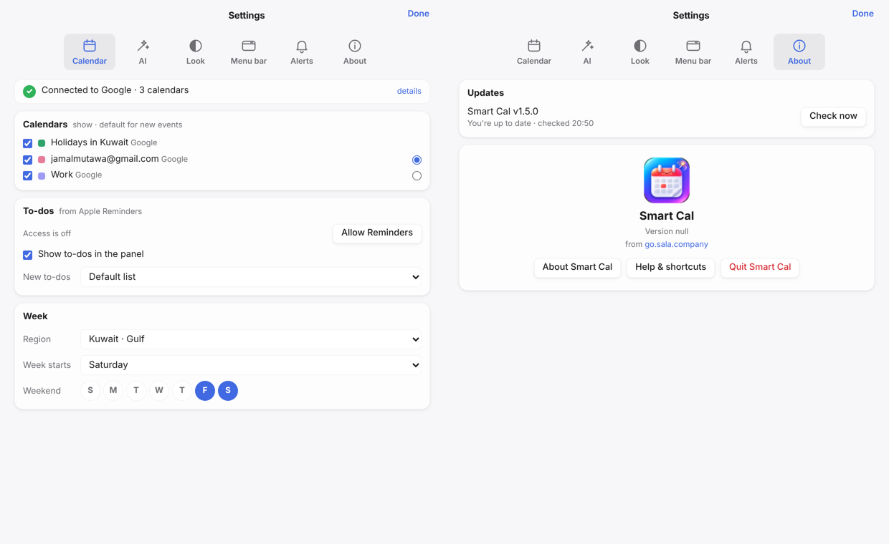
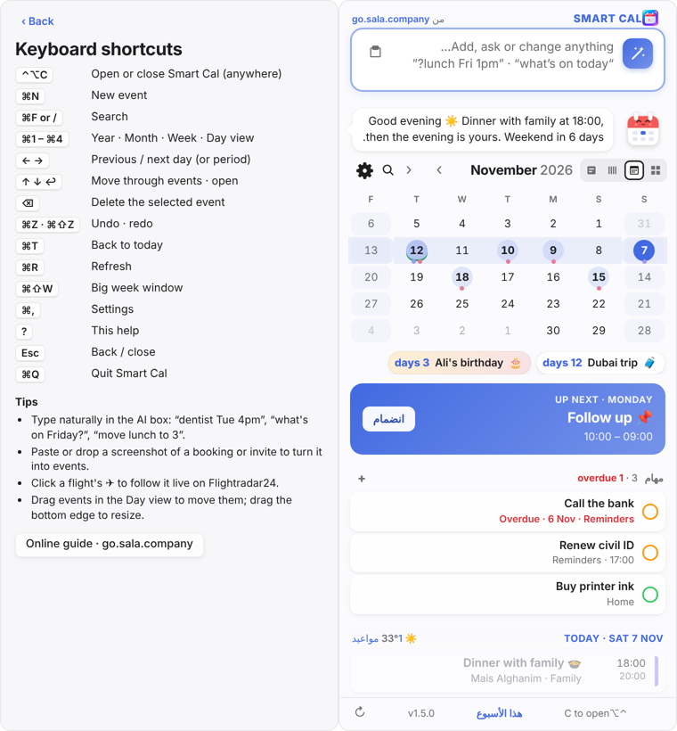
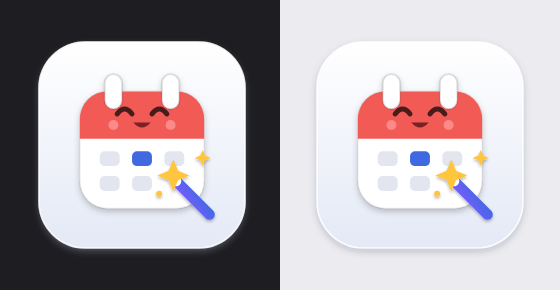
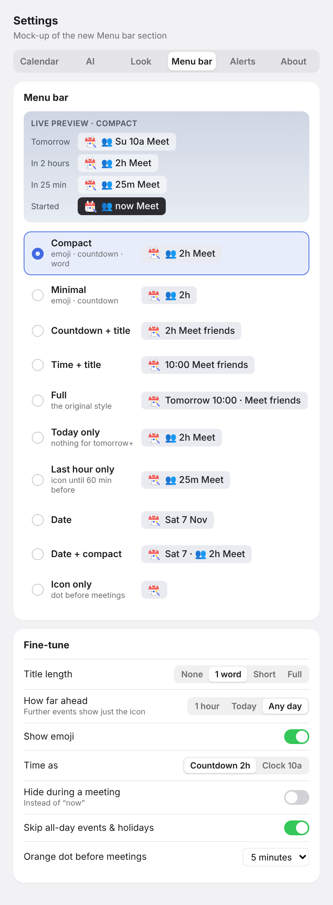
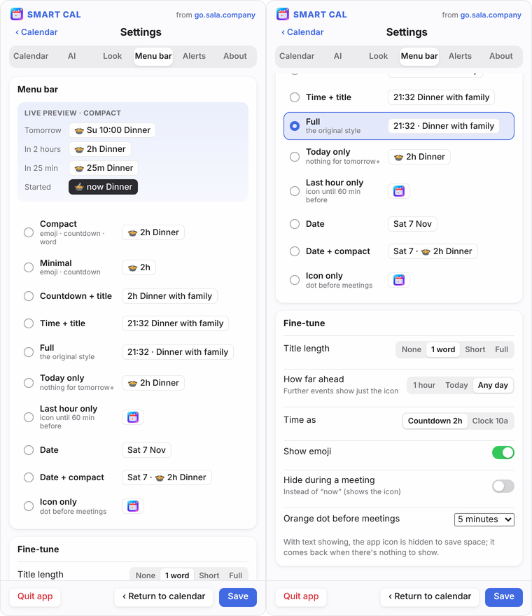
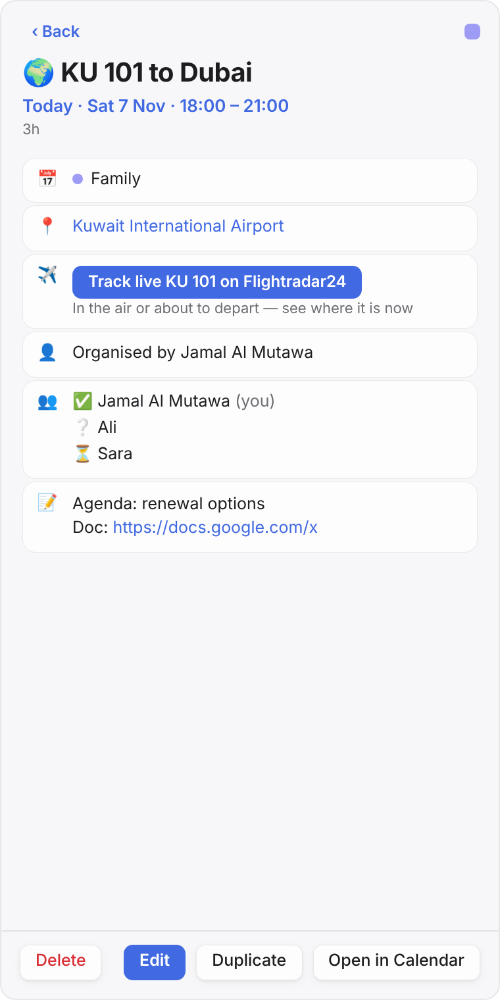
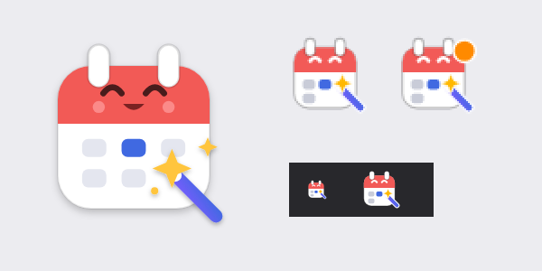
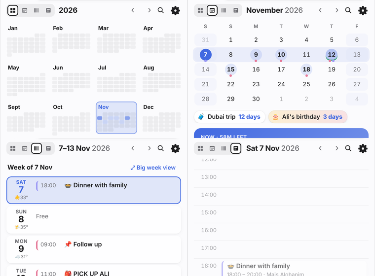
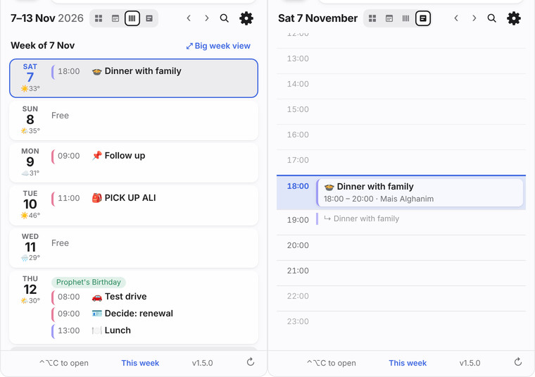

# Smart Cal — design log

How the app got its shape: each request from the owner (Jamal, "Mr. boss"), what was decided, and why.
Newest first. Screenshots are in [docs/design](docs/design). Release notes per version are in [CHANGELOG.md](CHANGELOG.md);
technical lessons are in [LESSONS.md](LESSONS.md).

## Standing principles

- **Private calendar.** No availability sharing or booking pages — "calendar remains private".
- **No Keychain prompts.** Keys and settings live in `~/Library/Application Support/PersonalCalendar/config.json` (mode 0600). The key is entered once.
- **Kuwait defaults.** Times shown in Kuwait time; week starts Saturday; weekend Friday + Saturday (region presets and custom days available).
- **Iterative, critique-driven.** Each round should improve meaningfully on the last; critiques are turned into numbered lists the owner picks from.
- **Menu bar space is precious.** Every character in the menu bar has to earn its place.
- **Nothing moves under your cursor.** Controls that you click repeatedly (view switcher, arrows) stay in fixed positions.
- **Behave like a Mac app.** System font at 13 pt, arrow cursor, light/dark and the Mac's accent colour, Reduce Motion / Increase Contrast, VoiceOver labels. Standard menus (About · Settings ⌘, · Quit ⌘Q; File · Edit · View · Window · Help), Mac keyboard symbols (⌃⌥⇧⌘), Settings that save instantly and close with the red button or ⌘W, the destructive button on the left and the main action on the right. Monochrome symbols in working UI; emoji only where Playful mode asks for them.
- **The AI never edits silently.** Every AI change shows a before/after preview and is applied only on a click; it touches only what the user mentioned, keeps notes and time zone, and date maths is done in code.
- **Only officially released platform features.** Beta or unreleased Apple features (like v2.1's Apple Intelligence and Siri) stay out of the shipped app.

---

## v2.2.6 — Update progress, due dates in words, week window menu (11 Nov 2026)

**Asked:** "add it to the week window too". **Decided:** the same menu, now in a shared `menu.js` (pop-up menu + date picker) used by both windows.

**Asked:** "when you do an update via the gear button and accept, everything pauses and the user doesn't know what's going on". **Decided:** a progress card in every open Smart Cal window — icon, title, the step in words with the download percentage, a bar (download = 0–80%, then Check, Install, Restart), and the four steps ticked off — plus "⬇︎ Updating 40%" in the menu bar, because the panel may be closed. Failures say what went wrong and that nothing was changed; if the restart takes over 20 s, it says to open Smart Cal from Applications. A second Update click while one runs is refused.

**Asked:** "i moved the todo for nbk to next week, but there is no indication when it is due, add a line saying when it is due relatively like after 4 days, or after 4 hours, or a date if its way off". **Decided:** the date plus the distance — "Today 21:00 · in 4 hours", "Tomorrow 09:00 · in 10 hours", "Wed 18 Nov, 09:00 · in 7 days", "Overdue by 13 hours" — and just the date from two weeks out. A weekday alone ("Wednesday") is never used for a date more than a few days away.

## v2.2.5 — Right-click to reschedule events (11 Nov 2026)

**Asked:** "add the same right-click reschedule to events".
**Decided:** the to-do menu's choices for every event row in the panel (one listener on the list, so the upcoming, day, week and timeline rows all get it): Today · Tomorrow · In 2 days · In 3 days · Next week (the day it's already on is left out), Pick a date…, then Open · Edit… · Duplicate · Delete. Moves keep the time of day and length (whole calendar days, so DST can't shift the clock), carry over notes and time zone, ask "this one or all future" for repeats, check clashes and offer Undo — the same path as drag-to-move. Read-only and holiday events get only Open/Duplicate. The big week window keeps drag-to-move for now.

## v2.2.4 — Right-click to reschedule to-dos (11 Nov 2026)

**Asked:** "i got these todos and i want to right click and reschedule after a few days, give me that option".
**Decided:** a Mac context menu on each to-do (opens at the pointer, nothing preselected): Today · Tomorrow · In 2 days · In 3 days · Next week, each with the date it lands on in grey, then Pick a date… (an inline date field), Remove date, Mark as done, Delete. Days count from today — rescheduling is about "not now", so an overdue to-do moved "in 3 days" lands 3 days from today, not 3 days after its old date. A to-do with a time keeps the time. Undo restores the old date. It saves only title and date, so the reminder's notes and list stay as they were.

## v2.2.3 — Notes, alerts and the waiting event (11 Nov 2026)

**Reported:** a screenshot of an event card with "240 h before" and notes reading `
Ali&#x27;s last day for his Dubai/UAE visa…
` — "fix this formatting error".
**Decided:** Google Calendar keeps descriptions as HTML and EventKit passes it through, so `notesText` (Go, `notes.go`) turns it into plain text where events are read — one place, so the card, the editor, search and the AI all get clean text. Plain notes pass through untouched. Alerts are written in the largest whole unit (weeks, days, hours).

**Reported:** "i have a meeting for saturday, but its not showing below the calendar". The screenshot showed the meeting still in the AI preview (not added), and "on Sun 15 Nov on Sun 15 Nov" in the box from double-clicking days.
**Decided:** a waiting event must be visible where you look for it: it shows in its day's list with an Add button and a dashed ring on its day; double-clicking a day while an event is waiting moves it there (the obvious intent) instead of typing into the box; the preview is labelled "Not added yet".

## v2.2.2 — …and the year (11 Nov 2026)

**Asked:** "add the year too". **Decided:** "Wednesday 11 November 2026", the year in the muted colour at a lighter weight. The longest dates ("Wednesday 30 September 2026") only just fit at 22 pt, so the line steps its size down (to 15 pt at most) when it would overflow — e.g. with Settings → text size above 100% — instead of being cut off with "…".

## v2.2.1 — Today's date first (11 Nov 2026)

**Asked:** "when opening smart cal from the menu bar have today's date prominently shown as the first line in large letters, because sometimes you just need to know what day it is".

**Decided:** the panel's first line is the date at 22 pt bold — weekday in the accent colour, then day and month ("Wednesday 11 November"); the year is in the tooltip, since the month header already shows it. It gets the full width so long dates never get cut off; the brand ("Smart Cal · from go.sala.company") moved to a small muted line underneath. It refreshes when the panel opens and at midnight, and uses the app's language.

## v2.2 — Siri & Apple Intelligence removed, Mac conventions, AI edit fixes (10 Nov 2026)

Screenshots: [panel](docs/design/v2.2-panel.png) · [event card](docs/design/v2.2-event-card.png) · [Settings](docs/design/v2.2-settings-window.png).

**Asked:** "remove the siri ai, it hasn't been officially released yet".
**Decided:** remove both halves of the v2.1 work — the Siri / Shortcuts actions and the Apple Intelligence engine — together with the Swift helper (`assistant/`) and `apple.go`. The AI box is OpenRouter / OpenAI only again (no engine setting), with the offline parser as the fallback; the greeting and event emojis need the key too. The v2.1 notes below are kept as history.

**Asked:** "look at the app, is it following mac gui and standards, if not fix it where needed".
**Found right already:** system font at 13 pt, arrow cursor, no text selection on controls, light/dark, accent colour, Reduce Motion, VoiceOver labels, Apple-ordered menu bar item menu, standard About panel, the week window.
**Fixed:** our own app menu (Smart Cal · File · Edit · View · Window · Help) instead of Wails' default, whose Help item loaded wails.io inside our window; event card with monochrome symbols, Delete left / Edit right / the rest in a ⋯ pop-up menu so the row never wraps; Settings window titled after the selected pane, no "Done"; ⌃⌥C written with Mac symbols instead of "ctrlaltc"; sentence-case section headings; the gear sized like the other toolbar icons.
**Kept:** the brand line at the top of the panel and the coloured *Up next* card — part of the look, not a platform convention.

**Asked:** "do all the fixes" (from a code review).
**Fixed:**
- "push it back by a week" moved events a week *earlier* — any "back" in the sentence flipped the direction, even in a title ("back massage"), and also skipped the into-the-past check. Now push back / postpone / delay always mean later; earlier needs "earlier", "sooner", "move it up" or "bring it forward".
- AI edits erased the notes (the event list carries none, and saving writes every field) and reset the time zone to local. Go now fetches the event first and carries both over, so every path gets it. Undo restores a changed repeat.
- The "only change what you mention" guards understood English only; Arabic keywords added.
- All-day moves across a DST change keep whole days.
- http:// links in notes open.
- Releases publish a SHA-256 next to the zip; the updater checks it and `codesign --verify` before swapping; releases run vet + tests first; CI unpacks the zip and checks it like the updater.
- Tests for date shifting, edit guards, applying changes and version comparison (`ai_test.go`).
**Not done:** splitting `frontend/app.js` — a refactor that needs the app running on a Mac to verify.

**Asked:** "why does my update function say im up to date?" → the changes were on a branch; a release is built only when `VERSION` changes on `main`. **Decided:** merged and published v2.2.0. From now on changes go **straight to `main`** ("dont do any new branches, update directly and we can revert back if needed") — and anything that bumps `VERSION` ships to everyone's Update button.

## v2.1.1 — AI edits that only change what you said (9 Nov 2026)

**Reported:** "i asked ai to move this item to 1 month from now, and it moved it to the past which was october… i meant 30 days from today which should be december 9". The preview also showed a new title, all-day for 31 days, a "Work" location and a monthly repeat.

**Decided:** relative moves are computed by Smart Cal, not the model ("N days/weeks/months from now", "later", "earlier", "push it by…"), keeping the event's time and length; edits keep every field the user didn't mention; and an edit that would land in the past without the user saying so is refused with a hint. The reported case is a unit test.

## v2.1 — Apple Intelligence & Siri (8 Nov 2026) — removed in v2.2

**Asked:** "can we use Siri AI through App Intents for the text box in the calendar menu?" → explained the two directions (Foundation Models = Apple's model inside our box; App Intents = Siri calling into Smart Cal) → "yes both".

**Decided:**
- **AI engine setting:** Auto (default) · Apple Intelligence · OpenRouter. Auto uses the on-device model for short everyday requests and OpenRouter for screenshots and long pasted text (the on-device model is small, with a small context window, and doesn't read images here). Failures fall back to OpenRouter when a key exists; with neither, the offline parser still handles simple lines.
- **Siri actions:** Add to Smart Cal · What's Next · Ask Smart Cal, with natural phrases; Siri asks a follow-up for the text. They go through the same AI, calendars and default alerts as the app. **Deleting by voice is refused** because it can't be undone.
- **Architecture:** a small Swift helper app, *Smart Cal Assistant*, inside `Smart Cal.app/Contents/Helpers`. It hosts the App Intents and runs Foundation Models on request (`--fm`, JSON in/out). The Go app stays the main program; the helper reaches it through a private Unix socket in the settings folder. Apple's model receives the same JSON Schema as OpenRouter, converted to a dynamic generation schema, so every AI feature works with either engine.

## v2.0 — Following Apple's Human Interface Guidelines (7 Nov 2026)

**Asked:** "apple has some gui rules like about, and other things, what are they if we were to apply them to the calendar app?" → a 17-point list → "do it all".

**Decided (all 17):**
1. Standard **About Smart Cal** panel (icon, version, credits, © go.sala.company).
2. Tray menu in Apple's order: About · Check for Updates… · Settings… (⌘,) · app items (Open, Week View ⌘⇧W, New Event ⌘N, Refresh ⌘R, Calendar app, Google web) · Smart Cal Help · Quit (⌘Q).
3. **Settings apply instantly** — the Save button was retired (it had been requested in v1.2; Apple's convention won once the owner chose "do it all"). A small "✓ Saved" tick confirms.
4. **Settings in their own window** with toolbar icon tabs (Calendar, AI, Look, Menu bar, Alerts, About).
5. **Monochrome (template) menu bar icon** option; colour remains the default.
6. **Show in the Dock** option, since the menu bar item can hide behind the notch; ⌃⌥C always works.
7. **Ask before adding a login item** (first run shows "Start Smart Cal when you log in?"). Existing installs keep their choice.
8. Shortcuts: ⌘N, ⌘Z / ⌘⇧Z, ⌘1–⌘4, ?, plus the existing ⌘F ⌘T ⌘R ⌘, Esc.
9. **System accent colour** and **system clock format** options (the Saturday week start stays a Smart Cal setting).
10. Accessibility: VoiceOver labels from tooltips, Reduce Motion, Increase Contrast, visible focus rings.
11–12. Undo over confirmations and just-in-time permissions were already in place.
13. Native polish: focus rings, toolbar tabs, system materials.
14. Week and Settings windows remember size and position.
15. App icon on Apple's rounded-square grid (mascot on a soft tile).
16. **Arabic** interface with right-to-left layout, Arabic dates (Latin digits) and an Arabic AI greeting.
17. **Help & shortcuts** sheet.

## v1.9 — Menu bar choices (7 Nov 2026)

**Asked:** "the next event is useful but i need to drastically abbreviate… 10 suggestions to allow more to show on the menu bar from other apps". Then: show examples of emoji + countdown; "4 is good"; "the actual app icon is wasting space, lets remove it, unless there is no forthcoming event"; "give the user a choice of style in the settings… show them as user choice examples… how they will appear in the settings"; "update it with menu bar choices".

**Decided:**
- Default label became **Compact**: emoji + countdown + one word — `👥 2h Meet`, `🦷 25m Dentist`, `👥 now Meet`, later days `✈️ Su 8a KU101` (about a third of the old width).
- The **app icon is hidden** whenever there is text; it comes back only when nothing is coming up (so there is always something to click). The "meeting in 5 minutes" orange badge moved from the icon into the text: `🟠 👥 4m Meet`.
- A new **Menu bar** settings tab with a live preview (tomorrow / in 2 h / in 25 min / started) and 10 styles, each shown as a mini menu bar:
  Compact · Minimal (`👥 2h`) · Countdown + title · Time + title · Full (original) · Today only · Last hour only · Date · Date + compact · Icon only.
- **Fine-tune** switches apply on top: title length (none / 1 word / short / full), how far ahead (1 hour / today / any day), countdown or clock, show emoji, hide during a meeting, orange-dot timing (off / 5 / 10 / 15 min).
- Old settings migrate: "Next event" → Full, "Within the hour" → Last hour only.

Mock-up that was approved: 
As built: 

Options considered and not chosen as default: initials (`MF 10a`, too cryptic), count of events left (`3 left`, doesn't say what's next), title-only (`Meet fri…`, loses the time).

## v1.8.4 — Flight tracking

**Asked:** "for flights reference, have the flight number open a flightradar link to allow us to see the flight especially when it is flying".

**Decided:** detect flight numbers (KU 101, EK857, "flight QR 1077") in the title, location and notes; a ✈︎ button opens `flightradar24.com/data/flights/<code>`. From 1 h before departure to 1 h after landing it reads **Track live** and pulses. Airline codes must be capitals unless the event mentions a flight/airport — otherwise "meet at 9" would match ("AT" is an airline). Flights get a ✈️ emoji.

## v1.8.3 — Cleaner icon

**Asked:** "i like this icon better (the greeting mascot), and put the ai magic wand on it, change everything to this cleaner icon".

**Decided:** the flat smiling-calendar mascot with a royal-blue magic wand and gold sparkles is the app icon, menu bar icon (a bolder simplified version for 22 pt) and panel brand mark. The greeting mascot itself stays wand-less so its face can change mood.

## v1.8.5 / v1.8.6 — Fixed view switcher, "you are here" highlights

**Asked:** "keep the year month week day keys position fixed, the jumping around confuses the view, or have them left aligned and static and the text representation to the right of it". Then: "highlight the current month in year, current week in month view, current day in week view, and current hour in day view".

**Decided:** the four view buttons sit at the far left and never move; the title follows them; arrows, search and gear are fixed on the right (the "back to today" dot reserves its space even when hidden). Highlights: current month tile (year), tinted band across the current week (month), tinted outlined today line (week), current-hour line (day).

## v1.8.2 — Week as lines, day as hours; calendar permission

**Asked:** "expand the week view as 1 day of the week per line / expand the day view as hourly view per line". Also: "clicked on allow… nothing happened… dont even know why i need to allow".

**Decided:** Week view = 7 lines (day, weather, every event; click a day to open it). Day view = 24 hour lines with "now" highlighted; click an empty hour to add there.
The Allow button now explains why access is needed (Smart Cal reads the Mac's calendars, which is where Google syncs), shows "Waiting for macOS…", clears a stale macOS answer and asks again, and falls back to opening the right Settings page. Builds are signed with a fixed designated requirement so the permission survives updates.

## v1.8.0 / v1.8.1 — AI box first; Year · Month · Week · Day

**Asked:** "move the ai text box right below the calendar (title), then the good evening and calendar follows. also right after November 2026, have an icon for year view, month view, weekly view, day view, with the selected view with a darker border". Then "expand the drop down if needed".

**Decided:** order is brand → AI box → greeting → calendar → countdowns → list. Segmented view switcher with a dark outline on the selected view. The drop-down grows to the screen height (up to 880 pt).

## v1.8.0 — "More practical and usable" critique

**Asked:** do 1 (repeating events, with AI help), 2 (clash warnings + free-slot finder), 3 (paste text and screenshots), 4 (undo everywhere), 5 (default alerts + leave-now travel time), 6 (Apple Reminders to-dos), 8 (pop-out week window), 10 (small fixes: search notes and the past year, configurable shortcut, settings tabs, time zones, text size). **Not** 7 (availability sharing — calendar stays private).

## v1.6 / v1.7 — "More fun" critique; rename

**Asked:** do everything except Kuwait-specific #4; week starts Saturday, weekend Fri + Sat adjustable by country; rename to **Smart Cal from go.sala.company**; a gear that looks like a gear.

**Decided:** mascot with moods, AI greeting, event emojis, weather, countdowns, weekly recap, timeline drag, confetti/sounds, AI voice — all behind one Playful switch.

## v1.0 – v1.5 — Foundations

- Menu bar calendar in Go; Fyne was replaced by **Wails v3** for a native-feeling UI.
- Google via the Mac's own calendar sync (EventKit) — "a simple 1 or 2 step process" instead of OAuth JSON files.
- **OpenRouter** (or OpenAI) for the AI box, which adds, answers, edits and deletes with before/after previews; an offline parser handles simple lines.
- Self-update from GitHub releases (repo made public so downloads work without a token).
- Settings with Save and Return; event days highlighted (dots were too small); royal blue default with a highlight-colour choice; the AI box with a big border, a magic-wand icon and two lines; a bigger gear.
