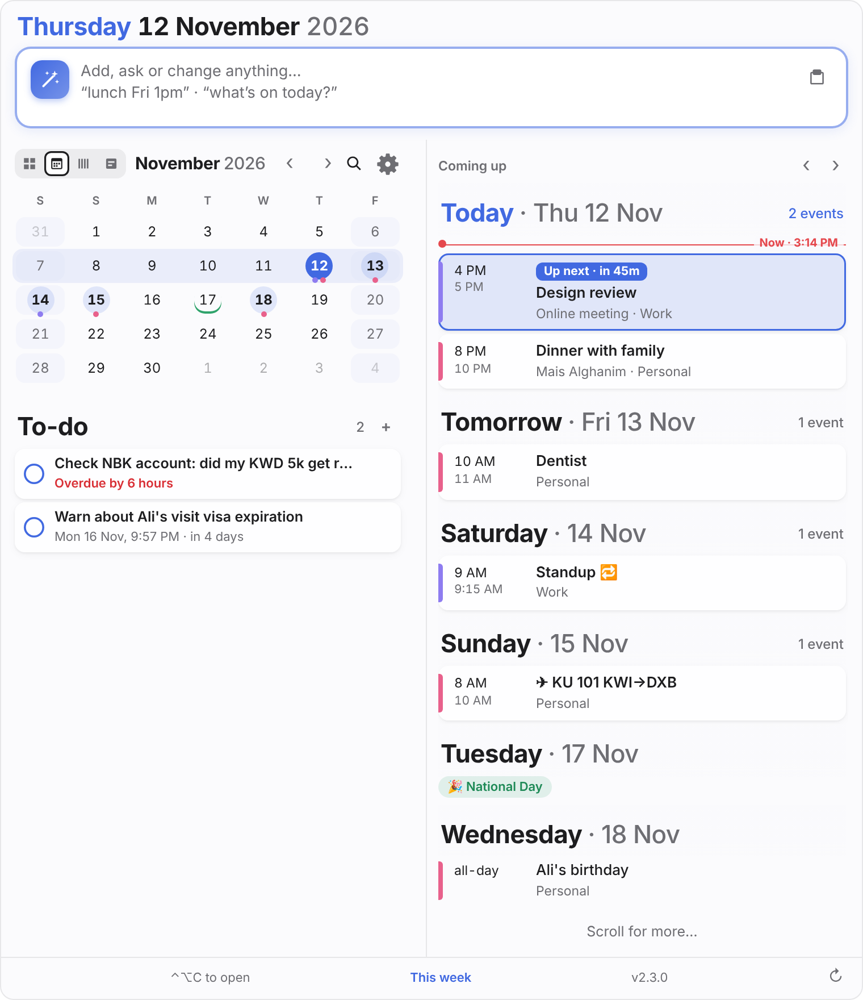
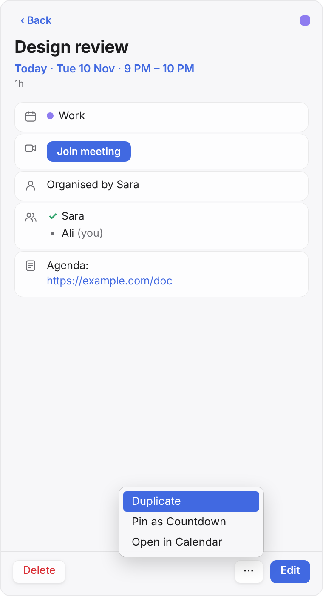
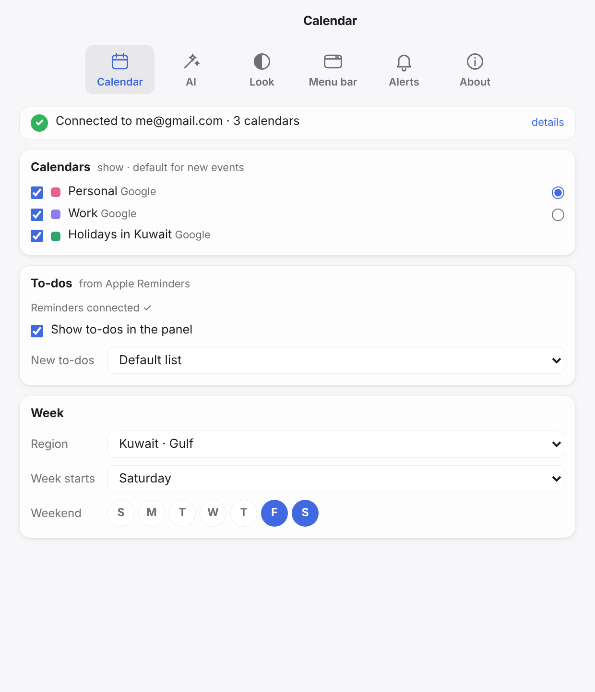

# Smart Cal 📅✨

*from [go.sala.company](https://go.sala.company)*

**Your calendar, one glance away — and it understands what you type.**

Smart Cal lives in your Mac's menu bar. It tells you what's next ("👥 2h Meet"), drops down a calendar when you click it, and lets you add, ask or change things in plain English or Arabic: *"dinner with Sara Thursday 8pm at Mais Alghanim"*, *"what's on tomorrow?"*, *"push the dentist back by a week"*. It works with Google Calendar through the Mac's own calendar sync — no Google sign-in, no cloud project, no fuss.

It's a free, Fantastical-style calendar written in Go with Wails v3 — and it went from first line to version 2.3 in about ten days, one conversation at a time. Every request and decision is in the [design log](DESIGN.md).

**[⬇︎ Download the latest release](https://github.com/jamalxcode/personalcalendar/releases/latest)** · [what's new](CHANGELOG.md) · [design log](DESIGN.md) · [lessons learned](LESSONS.md)

| The panel (wide layout) | An event | Settings |
|---|---|---|
|  |  |  |

---

## A sixty-second tour

**Look up — there's your next thing.** The menu bar shows the next event in as few characters as possible: `👥 2h Meet`, `🦷 25m Dentist`, `✈️ Su 8a KU101`. Ten styles to choose from, and an orange dot when a meeting is five minutes away.

**Click — today, loud and clear.** The first line is the date in big letters ("**Friday** 13 November 2026"), because sometimes you just need to know what day it is. Below: the AI box, the month with your to-dos, and an agenda that starts today and keeps going — tomorrow, the day after, and on, more loading as you scroll. The next event glows with a countdown ("Up next · in 26m · leave by 8:25"), and a red line marks *now*.

**Type like a human.** "lunch with Ali tomorrow 1pm" — added. "catch up with Miteb 60" — an hour-long event, and no "60" in the title. Paste an exam notice or a flight booking and it pulls out the date, time and place. Ask "am I free Saturday afternoon?" and it answers. Changes ("move lunch to 3pm") show a before/after first and touch only what you mentioned.

**Oops? Undo.** Every add, move and delete has Undo. New events are added straight away, so nothing waits in a preview you can forget.

**Right-click to say "not now".** Any event or to-do → Tomorrow, In 2 days, In 3 days, Next week, or Pick a date… — same time, same length, notes kept.

**Alerts with buttons.** Join the meeting, Snooze 10 minutes, or "Running late…", which drafts an email to everyone else. And at 8:00, a one-line morning brief: *"3 events · first 9:00 Dentist · leave by 8:35 · 1 to-do overdue."*

**Quick add from anywhere.** Press ⌃⌥N in any app (or ⌥-click the menu bar item), type, press ↩. Done — the box closes itself. Or select text in Mail or Safari, right-click → **Services → Add to Smart Cal**.

**Local colour.** The date line glows with the time of day and shows the weather. On National Day it says so; in Ramadan it shows today's Iftar and when Suhoor ends; on Eid it wishes you Eid Mubarak. Clear today's to-dos and it cheers — and keeps a streak.

**When something goes wrong, it says why.** Not "AI unavailable" but *"OpenRouter says your credits have run out (402) — add credits at openrouter.ai/credits."* And if you add a backup AI, it takes over when the main one fails.

**It keeps itself up to date.** A banner under the date says when there's a new version; one click and it installs, shows its progress, restarts, and says *"✓ Updated — all good."*

## Everything else it does

- **Year · Month · Week · Day** views, weekends shaded, the current period highlighted; a big **week window** (⌘⇧W) with drag-to-move and resize.
- **Event cards** with place (opens Maps), notes (Google's HTML shown as clean text), attendees, a Join button, and Delete · ⋯ · Edit.
- **Flights** — "KU 101" gets a ✈︎ button to Flightradar24, "Track live" while it's in the air.
- **Repeats, clash warnings and free-time finding** ("find an hour for the gym this week").
- **To-dos** from Apple Reminders, each saying when it's due ("Wed 18 Nov, 09:00 · in 6 days", "Overdue by 2 days").
- **Leave-now alerts** from Apple Maps drive times.
- **Search** (⌘F or /) through titles, places and notes, a year back and a year ahead.
- **Playful mode** (one switch): a mascot whose mood follows your day, an AI greeting, emojis on events, weather, countdowns, a weekly recap, confetti.
- **Arabic**, right-to-left, including in the AI box.
- **Kuwait-friendly defaults:** the week starts Saturday, the weekend is Friday + Saturday — with presets for the Gulf, Saudi, UAE, Egypt, Europe and the US.
- **A proper Mac citizen:** system font and accent colour, light/dark, Reduce Motion, VoiceOver labels, a standard About panel, Settings that save as you go, and a real menu bar when shown in the Dock.

### Keys

| | |
|---|---|
| `⌃⌥C` | open / close Smart Cal (from anywhere) |
| `⌃⌥N` · ⌥-click the menu bar item | quick add (from anywhere) |
| `⌘N` · `⌘Z` / `⌘⇧Z` | new event · undo / redo |
| `⌘1`–`⌘4` · `⌘T` | Year / Month / Week / Day · today |
| `⌘F` or `/` · `⌘R` | search · refresh |
| `⌘⇧W` · `⌘,` | week window · settings |
| `↑↓` `↩` `⌫` · `← →` | move, open, delete in the agenda or list · previous / next day |
| `T` · `E` · `Space` | on a selected event: move to tomorrow · edit · open |
| `↑` in the AI box | what you typed before |
| `?` · `Esc` · `⌘W` · `⌘Q` | help · back / close · close · quit |

## Get it (Apple silicon, macOS 14+)

1. Download **SmartCal-…-macos-arm64.zip** from the [latest release](https://github.com/jamalxcode/personalcalendar/releases/latest), unzip, and drag the app into **Applications**. (Inside the zip it's called "Personal Calendar.app" so very old versions can still update; it renames itself to **Smart Cal** on first launch.)
2. The first time, macOS blocks it because it isn't signed with an Apple Developer ID: **System Settings → Privacy & Security → Open Anyway** (or in Terminal: `xattr -dr com.apple.quarantine "/Applications/Personal Calendar.app"`). Updates after that install themselves.
3. **Allow** calendar access when asked.
4. Google account not on the Mac yet? Click **Add Google…** in Smart Cal — it opens System Settings → Internet Accounts. Keep *Calendars* ticked and your calendars appear by themselves (iCloud and Exchange work too).

**The AI:** paste an **OpenRouter** key (`sk-or-…`, from [openrouter.ai/keys](https://openrouter.ai/keys)) or an **OpenAI** key (`sk-…`) in Settings → AI. Smart Cal checks it with the service right away and shows exactly what it will use ("→ Uses gpt-4o-mini via OpenAI"). Paid models need a little credit — Smart Cal uses very little. Add a **backup AI** (ideally another company) for when the main one is down. No key? Simple lines like "dentist Thursday 3pm" still work.

**Menu bar full?** On a MacBook with a notch, macOS hides items that don't fit. ⌘-drag Smart Cal where you want it (it stays there), or turn on Settings → Menu bar → *Also show in the Dock* — that also lists it in Force Quit.

## What leaves your Mac

Your calendars stay in macOS. When you use the AI, the text you typed and the nearby events it needs go to your AI service. Weather asks Open-Meteo for your city; updates ask GitHub. Settings and keys live in `~/Library/Application Support/PersonalCalendar/config.json` (mode 0600) — deliberately not the Keychain, so there are no password prompts.

## By the numbers

- **45** releases published, from v1.0 to v2.3.9
- **~13,000** lines of Go, Objective-C, JavaScript, HTML and CSS — no Node, no npm, no build step for the UI
- **20** Go test functions, plus an AI test set of real sentences in English and Arabic
- **87** lessons learned, the hard way
- **0** Google Cloud projects, password prompts or tracking

## For builders

Needs Go (the Go 1.26 toolchain is fetched automatically) and Xcode command-line tools.

```bash
git clone https://github.com/jamalxcode/personalcalendar.git
cd personalcalendar
./build.sh --run        # builds "Smart Cal.app" onto your Desktop and opens it
```

**Tests:** `go test ./...` on a Mac (the package uses cgo and EventKit). The AI test set runs against the real AI with `SMARTCAL_EVAL_KEY=sk-or-… go test -run TestAIEval -v` — add a line for every sentence it gets wrong.

**Previewing the UI without a Mac:** load `frontend/` in Playwright with `/wails/runtime.js` routed to a small mock (see [LESSONS.md](LESSONS.md)). Every UI change in the design log was checked this way, light and dark, wide and compact.

**How changes ship:** straight to `main`, no feature branches. Bump `VERSION`, add a `## vX.Y.Z` section to [CHANGELOG.md](CHANGELOG.md) (it becomes the release notes in the app), push. The *Release* workflow runs vet and the tests, builds on a macOS runner and publishes `SmartCal-X.Y.Z-macos-arm64.zip` with its `.sha256`. A `VERSION` like `2.4.0-beta.1` becomes a pre-release that only *Get beta versions* installs. Pushes that don't change `VERSION` publish nothing.

### Code map

| File | What |
|---|---|
| `main.go` | the app: menu bar item, app menu, panel / week / Settings / quick-add windows, global shortcuts, refresh loop, alerts, morning brief, "just updated" |
| `service.go` | `CalService` — everything the UI calls (state, AI, add/change/delete, to-dos, settings, updates) |
| `ai.go` (+ `ai_test.go`, `ai_eval_test.go`, `testdata/ai_eval.json`) | the AI: one structured call for add / answer / update / delete / slots / to-do; edit guards (English + Arabic), exact relative dates, backup AI |
| `aidiag.go` (+ `aidiag_test.go`) | why the AI failed, in plain words; which service a key belongs to, and checking it |
| `parse_local.go` (+ test) | the reader that works without AI (simple lines, full dates, pasted notices) |
| `notes.go` (+ test) | Google Calendar's HTML notes → plain text |
| `calendar_darwin.go`, `eventkit_darwin.m` | EventKit and AppKit bridge: calendars, events, reminders, menu bar tricks |
| `updater.go` | finding, downloading, checking and installing updates (stable or beta) |
| `types.go`, `fun.go`, `config.go`, `icons.go` | repeats, free slots and clashes · weather, greeting, emojis, countdowns · settings · icons |
| `frontend/` | `index.html` + `app.js` + `style.css` (panel, Settings, quick add), `week.*` (week window), `menu.js` · `dates.js` · `flights.js` · `seasons.js` (Hijri dates, occasions, prayer times) (shared), `i18n.js` (Arabic) |
| `.github/workflows/` | `release.yml` (vet, test, build, publish on a `VERSION` change) · `ci.yml` (the same checks on other branches) |
| `build.sh` | compile, bundle as a menu-bar-only `.app`, sign ad hoc, package |

### The docs

| | |
|---|---|
| [DESIGN.md](DESIGN.md) | every request and what was decided, newest first — the conversation behind the app |
| [docs/BUSINESS-RULES.md](docs/BUSINESS-RULES.md) | what Smart Cal does, as rules |
| [docs/INTERFACE-RULES.md](docs/INTERFACE-RULES.md) | how it looks and behaves |
| [docs/IDEAS.md](docs/IDEAS.md) | what could come next (and what was decided against) |
| [LESSONS.md](LESSONS.md) | what building it taught us, by topic |
| [CHANGELOG.md](CHANGELOG.md) | every release, in plain words |

---

*Smart Cal started life as "Personal Calendar" in Fyne, moved to Wails v3 to get a real drop-down under the menu bar, learned to speak Arabic, briefly made friends with Siri, and grew up one request at a time. Made with care in Kuwait.* 🇰🇼
