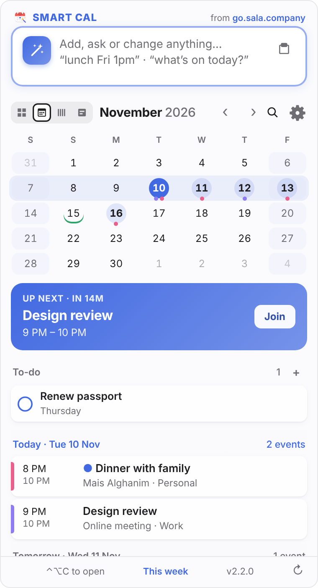
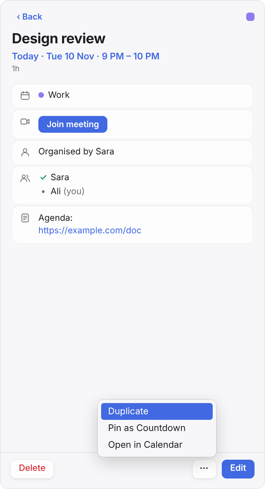
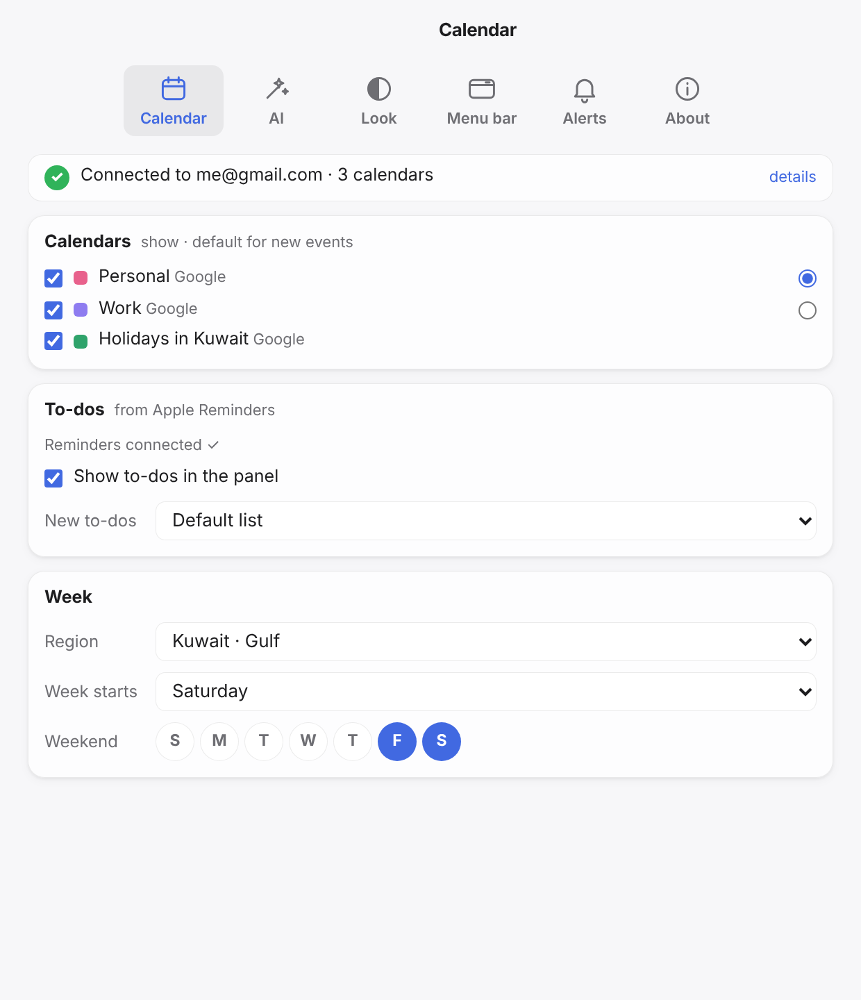

# Smart Cal

*from [go.sala.company](https://go.sala.company)*

A Fantastical-style **macOS menu bar calendar**, written in Go with **Wails v3** (native WebKit UI), that works with your **Google Calendar** (through macOS's own calendar sync — no Google Cloud setup) and understands plain-English event entry with **OpenRouter / OpenAI**.

**Latest:** [download the newest release](https://github.com/jamalxcode/personalcalendar/releases/latest) · [what's new](CHANGELOG.md) · [design log](DESIGN.md)

- **Menu bar** shows the next event compactly — `👥 2h Meet`, `🦷 25m Dentist`, `✈️ Su 8a KU101` — with no icon while there is text. Ten styles plus fine-tune options in Settings → Menu bar.
- **Panel** (click the menu bar text or press **⌃⌥C**, configurable): the AI box on top, a greeting, then Year / Month / Week / Day views (week = one line per day, day = one line per hour) with highlighted event days, weekends shaded and the current period highlighted, an *Up next* card with countdown + **Join**, and your upcoming events by day. Holidays show as small tags.
- **Click a day** for that day's agenda; **click an event** for its card — time, place (opens Maps), notes, attendees, Join — with **Delete** on the left, **Edit** on the right and a **⋯** menu for Duplicate, Pin as Countdown and Open in Calendar.
- **AI box**: add (`dinner with Sara Thursday 8pm at Mais Alghanim`), ask (`what's on Thursday?`, `am I free tomorrow afternoon?`) or change (`move lunch to 3pm`, `push the dentist back by a week`, `move this to 1 month from now`, `cancel Friday's dentist`) — changes show a before/after preview first, only touch what you mention (in English or Arabic), keep the event's notes and time zone, and relative dates are calculated exactly. Uses your OpenRouter or OpenAI key; simple lines work offline without one.
- **Flights**: flight numbers (KU 101, EK857) get a ✈︎ button that opens Flightradar24 — "Track live" while the plane is in the air.
- **Search** (⌘F or `/`) across titles, places and notes, the past year and the next.
- **Meeting alerts** with a Join button, optional **start at login** (it asks), **highlight colour** of your choice (or the Mac's), self-**updates** from GitHub.
- **Playful mode** (one switch): a mascot whose mood follows your day, an AI greeting and emojis on events (these two need the AI key), weather, countdowns (pin events; birthdays automatic), a weekly recap, confetti, optional sounds, and a choice of AI voice.
- **Day timeline**: drag events to move them, drag the bottom edge to resize, Undo, double-click to add.
- **Repeating events, clash warnings and free-slot finding**, by typing or in the editor; editing a repeat asks "this one or all future".
- **Paste or drop** text and screenshots (flight bookings, invites) to create events; **Undo** for every change.
- **To-dos** from Apple Reminders, default alerts, and **Leave now** alerts from Apple Maps drive time.
- **Big week window** (⌘⇧W): drag across days, resize, double-click to add.
- **A proper Mac app:** Settings window that saves instantly (⌘,) and is titled after the pane you're on, standard About panel, Apple-ordered menu bar item menu, a full menu bar (Smart Cal · File · Edit · View · Window · Help) when shown in the Dock, system accent colour and clock, Reduce Motion / Increase Contrast, VoiceOver labels, monochrome icon or Dock icon options, Arabic with right-to-left layout.
- **Week settings**: week starts Saturday, weekend Fri+Sat by default — presets for the Gulf, Saudi, UAE, Egypt, Europe and US, or pick your own days.
- Keys: `⌃⌥C` toggle · `⌘N` new · `⌘Z`/`⌘⇧Z` undo/redo · `⌘1–4` Year/Month/Week/Day · `⌘⇧W` week window · `?` help · `↑↓` move · `↩` open · `⌫` delete · `← →` previous/next day · `⌘F` search · `⌘R` refresh · `⌘T` today · `⌘,` settings · `⌘W` close · `Esc` back/close.

Design decisions and the conversations behind them: [DESIGN.md](DESIGN.md).

| Panel | Event card | Settings |
|---|---|---|
|  |  |  |

## Install (new Mac)

1. Download **SmartCal-…-macos-arm64.zip** from the [latest release](https://github.com/jamalxcode/personalcalendar/releases/latest) (Apple silicon Macs, macOS 14 or later).
2. Double-click the zip and drag the app into **Applications**. (Inside the zip it's called "Personal Calendar.app" so older versions can update; it renames itself to **Smart Cal** on first launch.)
3. Open it. The app isn't signed with an Apple Developer ID, so the first time macOS blocks it: open **System Settings → Privacy & Security**, scroll down and click **Open Anyway** (or, in Terminal: `xattr -dr com.apple.quarantine "/Applications/Personal Calendar.app"`). After that it opens normally — and updates install themselves without this step.
4. Follow the two clicks under **Setup** below.

Already installed? Use **Update** in Settings → About (or right-click the menu bar item → Check for Updates…).

## Build (on your Mac)

Needs Go 1.21+ (`brew install go`; it auto-fetches the Go 1.26 toolchain Wails v3 needs) and Xcode command-line tools (`xcode-select --install`). No Node/npm needed — the UI is plain HTML/CSS/JS.

```bash
git clone https://github.com/jamalxcode/personalcalendar.git
cd personalcalendar
./build.sh --run        # builds "Smart Cal.app" onto your Desktop and opens it
```

Drag it into /Applications. Smart Cal asks once whether to start at login (also in Settings → Alerts).

**Tests:** `go test ./...` (on a Mac — the package uses cgo and EventKit). `ai_test.go` covers the AI edit safeguards (relative moves, "push back", fields you didn't mention, Arabic keywords), `parse_local_test.go` the offline parser, free slots and menu bar labels. CI runs them, plus `go vet` and a full build, on every push to a branch.

## Setup (2 clicks)

1. **Allow** — on first launch macOS asks for calendar access. Click Allow.
2. **Google account** — if your Google account isn't on the Mac yet, click **Add Google…** in the app. It opens System Settings → Internet Accounts; sign in with Google and keep *Calendars* ticked. Your calendars show up in the app by themselves.

**AI:** paste an OpenRouter key (`sk-or-…`, from <https://openrouter.ai/keys>) or an OpenAI key (`sk-…`) in Settings → AI; the app detects which. Without a key, simple lines ("dentist Thursday 3pm") still work offline.

Works with every calendar macOS syncs — Google, iCloud, Exchange — and you choose which ones to show and which one new events go to.

## Updates

The app checks GitHub for a newer release at launch and every 6 hours. When one exists an **Update to vX** pill appears in the panel footer (also Settings → Updates, or right-click the menu bar icon → Check for Updates…). One click downloads it, checks it against the SHA-256 published with the release and verifies the app's signature, then swaps the app in place and relaunches. If you're told you're up to date, there is simply no newer release yet — changes only reach the Update button once they're merged into `main` with a new `VERSION`.

**Publishing a new version:** bump `VERSION`, add a `## vX.Y.Z` section to `CHANGELOG.md` (those lines become the release notes shown in the app), push to `main` (or merge a pull request that does). The *Release* workflow runs `go vet` and the tests, builds the app on a macOS runner and attaches `SmartCal-X.Y.Z-macos-arm64.zip` plus its `.sha256` to a new GitHub release. Pushes that don't change `VERSION` don't publish anything.

> Since v1.8.2 builds keep a stable signature, so macOS remembers the calendar permission across updates.

## Where things are stored

`~/Library/Application Support/PersonalCalendar/config.json` (folder name kept from the original name) (settings + AI key, file mode `0600`; deliberately not the Keychain, so there are no password prompts). Calendar data stays in macOS. With OpenRouter/OpenAI, only the text you type (plus the upcoming events it needs for context) is sent.

## Code map

| File | What |
|---|---|
| `main.go` | Wails app, menu bar item (label + icon + right-click menu), the app's menu bar (File · Edit · View · Window · Help), popover window attached to the tray, global hotkey, refresh loop |
| `service.go` | `CalService` — the Go methods the UI calls (state, setup steps, parse, add, delete, settings) |
| `frontend/` | the panel and Settings window (`index.html`, `style.css`, `app.js`), the week window (`week.*`) and Arabic (`i18n.js`); they talk to Go via `/wails/runtime.js` |
| `eventkit_darwin.m` | Objective-C bridge to Apple EventKit: permission, calendars, events, add, delete, change notifications |
| `calendar_darwin.go` | Go wrapper over the bridge (+ Meet/Zoom/Teams link detection) |
| `ai.go` (+ `ai_test.go`) | structured AI requests (OpenRouter / OpenAI): one call decides add / answer / update / delete / slots / to-do; edit guards (English + Arabic) and exact relative dates |
| `types.go` | repeats, alarms, to-dos, free-slot and clash helpers |
| `fun.go` | weather (Open-Meteo), greeting, emoji cache, countdowns |
| `parse_local.go` (+ `parse_local_test.go`) | offline parser for simple lines when there's no key or no network |
| `config.go` | settings file |
| `icons.go` | app, menu bar (colour + monochrome) icons; sources in `assets/src` |
| `updater.go` | checks GitHub releases, downloads the zip, verifies its SHA-256 and signature, swaps the bundle, relaunches |
| `.github/workflows/release.yml` | vets, tests, builds + publishes a release (zip + `.sha256`) when `VERSION` changes on `main` |
| `.github/workflows/ci.yml` | vets, tests, builds and checks the unpacked zip's signature on every push to a non-main branch, on a macOS runner |
| `build.sh` / `build.command` | compile (`-tags production,private_mac_apis`), bundle as a menu-bar-only `.app`, ad-hoc sign, copy to Desktop |
